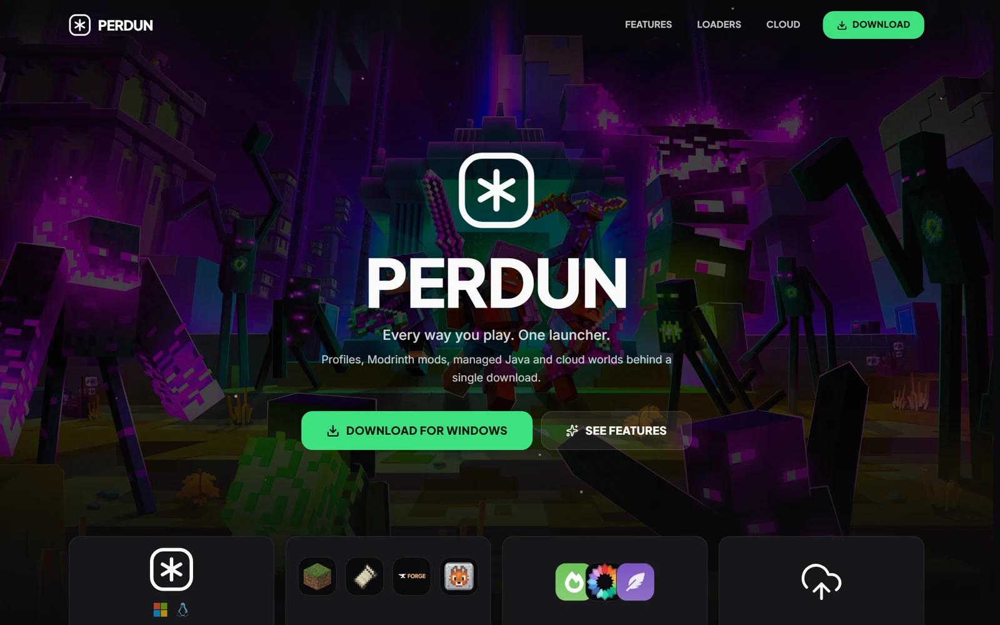
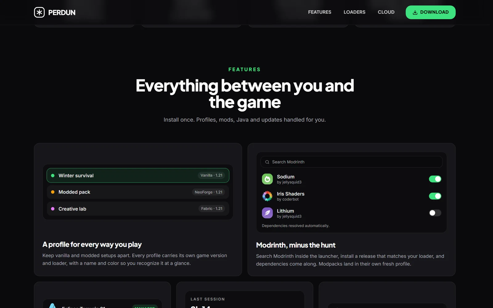
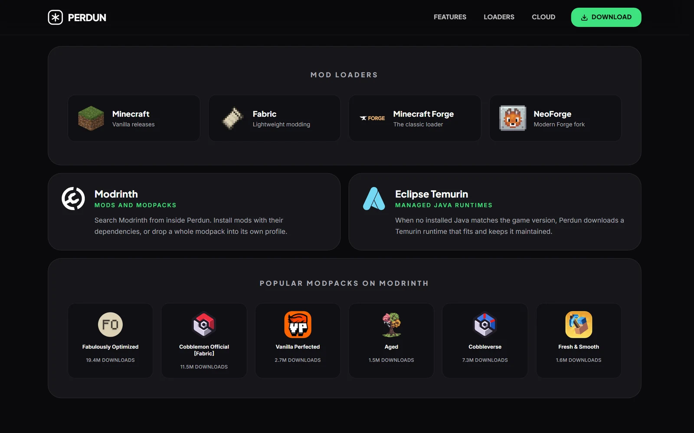
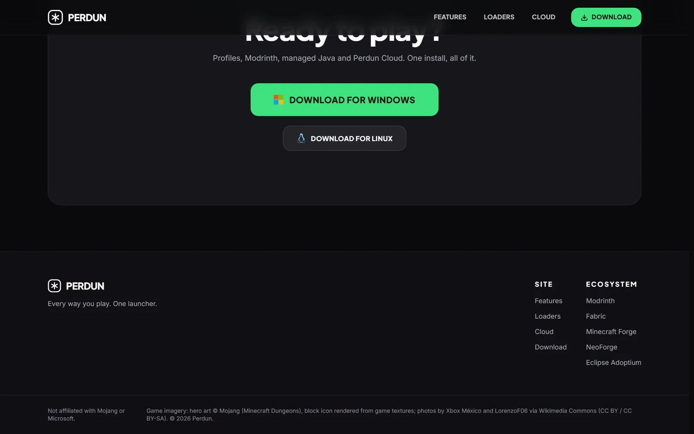
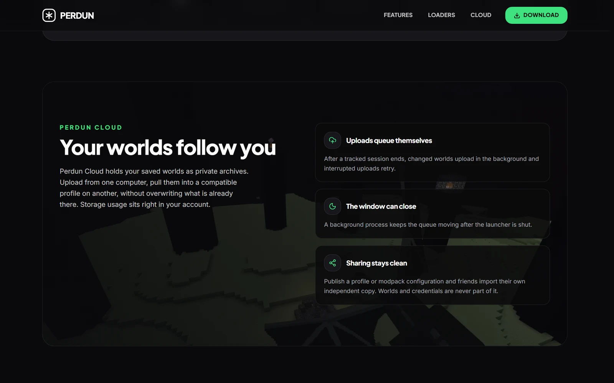
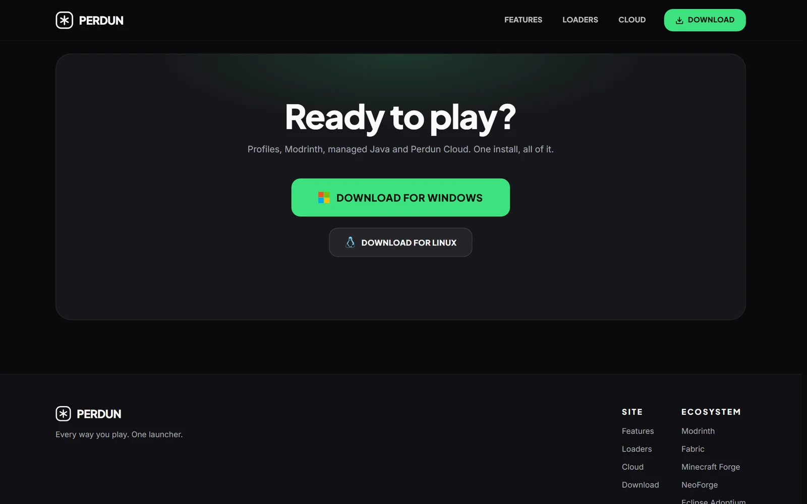
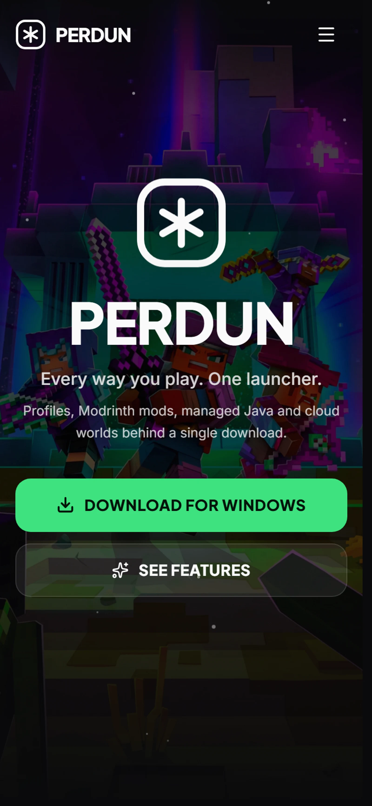

<div align="center">



# Perdun Landing Page

**Every way you play. One launcher.**

Marketing site for Perdun, a desktop launcher for vanilla and modded Minecraft.


</div>

---

## What it sells

| | |
|---|---|
| **One install** | Single download for Windows and Linux, with managed Eclipse Temurin Java runtimes |
| **Every loader** | Vanilla, Fabric, Minecraft Forge and NeoForge, one profile each with its own game version |
| **Modrinth built in** | Search Modrinth inside the launcher; dependencies resolve automatically, modpacks land in their own profile |
| **Perdun Cloud** | Saved worlds upload in the background and follow you between computers |

## Preview

<div align="center">
<table>
  <tr>
    <td width="50%" align="center"><strong>Interactive bento</strong><br></td>
    <td width="50%" align="center"><strong>Loaders, partners, real modpacks</strong><br></td>
  </tr>
  <tr>
    <td width="50%" align="center"><strong>Top modpacks from the Modrinth API</strong><br></td>
    <td width="50%" align="center"><strong>Perdun Cloud</strong><br></td>
  </tr>
  <tr>
    <td width="50%" align="center"><strong>Download</strong><br></td>
    <td width="50%" align="center"><strong>Mobile</strong><br></td>
  </tr>
</table>
</div>

The feature bento is not screenshots-of-the-app - the profile picker and mod
toggles are real interactive components, and the modpack strip is a live
snapshot (top packs by follows, real icons and download counts from the
Modrinth API).

## Stack

- [Vite](https://vite.dev) + [React 19](https://react.dev) + [Tailwind CSS 4](https://tailwindcss.com)
- [Motion](https://motion.dev) for spring-based reveals (`reducedMotion` respected)
- [Biome](https://biomejs.dev) for lint + format, strict `tsc`
- Static output (`dist/`), deployed as a
  [Cloudflare Workers static asset](https://developers.cloudflare.com/workers/static-assets/) -
  no server, no runtime, nothing to maintain

## Getting started

```sh
bun install
bun run dev        # http://localhost:3000
bun run build      # static site in dist/
bun run preview    # serve the build
```

## Deploy

```sh
bunx wrangler login
bun run deploy     # vite build && wrangler deploy
```

## Repo hygiene

- No tracking, no analytics, no cookies
- Zero lint errors (`bunx biome check`), zero `tsc` errors
- Only assets that are actually referenced live in `public/`

Game imagery: hero art is Mojang's Minecraft Dungeons key art, the block icon
is rendered from the game's own textures, in-game photos by Xbox M&eacute;xico
and LorenzoF06 via Wikimedia Commons (CC BY / CC BY-SA). Not affiliated with
Mojang or Microsoft.
